<div align="center">

# सारthi · Sarthi

> **सारथी**, the charioteer who steers the rider.
> A voice-and-chat life coach that files your whole day into four typed stores — and **never saves a guess without asking.**


**OpenAI DevDay 2026 — "Sarthi inside ChatGPT"** · built on the OpenAI Build Week spine (*Apps for your life*)

[**Live app**](https://sarthi-gray.vercel.app) · [**Try the demo (no sign-up)**](https://sarthi-gray.vercel.app/api/try-demo) · [**ChatGPT setup page**](https://sarthi-gray.vercel.app/mcp/info) · [**Code: `hack/devday-chatgpt`**](https://github.com/SawhneySatvik/Sarthi/tree/hack/devday-chatgpt) · [**Build Week video**](https://www.youtube.com/watch?v=DtNvdCOvIY4)

</div>

---

## Table of contents

1. [What's new at DevDay](#1-whats-new-at-devday)
2. [The product](#2-the-product)
3. [Sarthi inside ChatGPT — the user journey](#3-sarthi-inside-chatgpt--the-user-journey)
4. [How OpenAI is used](#4-how-openai-is-used)
5. [Architecture](#5-architecture)
6. [The trust pipeline](#6-the-trust-pipeline)
7. [Multi-user and identity](#7-multi-user-and-identity)
8. [Database design](#8-database-design)
9. [To-dos](#9-to-dos)
10. [Decisions API (GPT-6 Luna) details](#10-decisions-api-gpt-6-luna-details)
11. [Security and hardening](#11-security-and-hardening)
12. [Provider matrix](#12-provider-matrix)
13. [Run locally](#13-run-locally)
14. [Testing and quality](#14-testing-and-quality)
15. [Deployment](#15-deployment)
16. [Known limitations and roadmap](#16-known-limitations-and-roadmap)
17. [License](#17-license)

---

## 1. What's new at DevDay

Sarthi already existed as a web app (capture sheet, four lenses, a coach). For DevDay it became a **ChatGPT app**: you talk to ChatGPT, and Sarthi's server decides what is safe to save.

- **A ChatGPT plugin over MCP, with an inline MCP Apps panel.** Seven tools (`log_entries`, `confirm_entry`, `undo_last`, `get_today`, `setup_space`, `add_todo`, `complete_todo`) plus a `ui://sarthi/panel.html` resource rendered inline under ChatGPT's reply, with a sidebar launcher for *Today* (`mcp/register.ts`, `mcp/panel.html`).
- **ChatGPT's model is the parser; Sarthi is the verifier.** ChatGPT fills a typed zod tool schema. Every number it supplies is checked by pure code against the user's verbatim words (`core/capture/verify.ts`); anything not literally said is demoted to a card.
- **Only the user's tap confirms.** `confirm_entry` is registered with `ui.visibility: ["app"]` (panel-only) and every card carries an HMAC token the model never sees (`mcp/tools.ts`).
- **A second, independent verifier: the OpenAI Decisions API (`gpt-6-luna`).** One batched call per message of predicates ("did the user really state ₹450?") and choices (map "sys design" onto the user's existing skill). It can only make Sarthi stricter — demote or suggest, never promote or invent (`mcp/decisions.ts`, `providers/decisions/`).
- **Multi-user from day one, no forms.** `MULTI_USER=1` gives every ChatGPT account its own Sarthi space keyed on the anonymized `openai/subject`, provisioned on first sight, with "today" computed from `openai/userLocation.timezone`. A to-do layer and a `"via ChatGPT"` badge in the web app close the loop.

---

## 2. The product

**The problem.** Most of us track our lives in pieces — a food app, a budget app, a habit tracker, notes for whatever we are learning. Logging the same day in four places is enough friction that people quietly stop. And the AI loggers that promise to fix that tend to *invent* numbers.

**Who it is for.** People who want to track food, spending, habits and learning, but quit apps because logging is tedious — and who do not trust an AI that silently writes a wrong calorie count.

**What Sarthi does.** You say one ordinary sentence:

> *"spent ₹340 on lunch, 2 rotis and dal, drank a bottle, 90 min of system design, woke at 5:10"*

and it files that into **four typed domains at once**:

| Domain | Shape | Stores |
|---|---|---|
| **Health** | a daily arc | meals + items, water, workouts + exercises, weigh-ins |
| **Money** | an arc plus a ledger | categories, transactions, recurring rules, budgets |
| **Habits** | a daily arc | habits, logs, satisfaction rules (a workout can tick "Exercise") |
| **Skills** | hours toward mastery | skills, milestones, sessions |

**The one rule: nothing estimated writes unconfirmed.** Explicit values (`estimated:false`, confidence ≥ 90.00%) file silently. Anything estimated — the kcal in that lunch, the ml in "a bottle" — becomes a card you **Keep / Edit / Discard**, and you can flip it to see *why* it guessed. Every write lands in its own typed table, through one commit service, and is undoable. Money is whole paise; quantities are whole ml / minutes / grams; confidence is basis points. No floats for money, ever.

A three-tier coach sits on top: it reacts to what you log, briefs daily, reflects weekly, and changes your plan glass-box (before → after → reason, revertible).

### A look at the web app

| | |
|:--:|:--:|
| **Today** is where your day lives | **Capture** turns a sentence into confirmable entries |
| 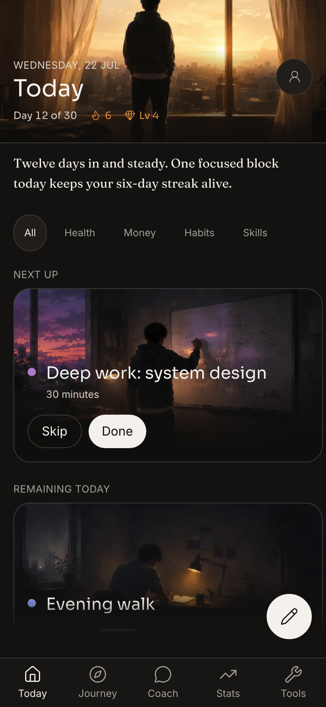 | 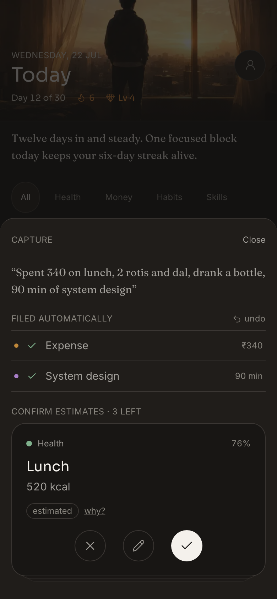 |
| **The coach** shows its plan changes in the open | **Stats** is the progress you actually earned |
| 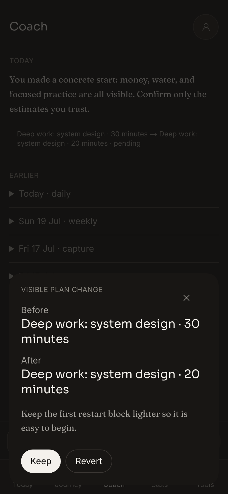 | 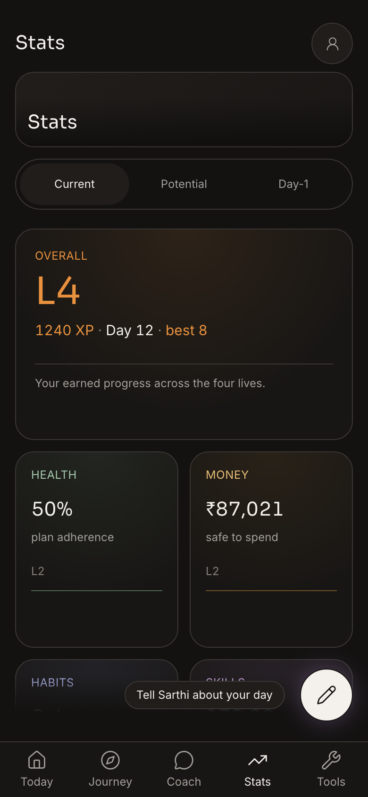 |
| **A domain lens**, here your Health rings | **Journey**, your days written down |
| 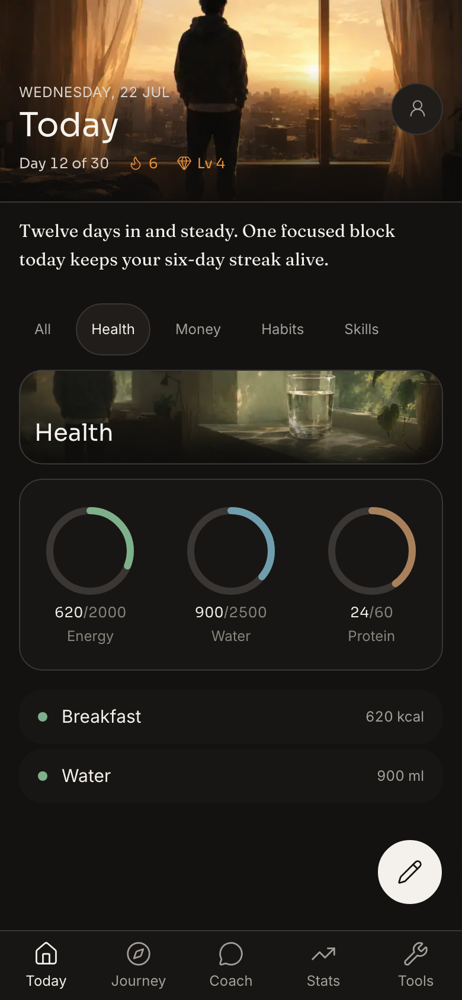 | 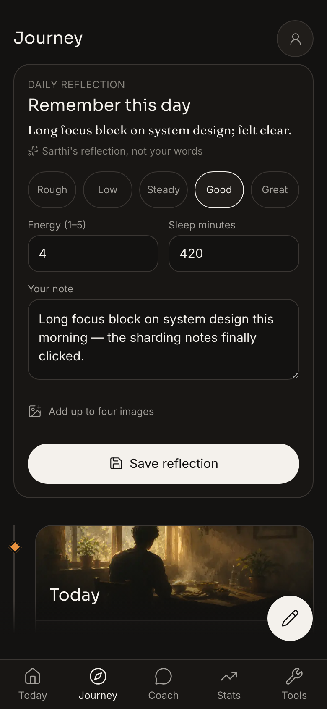 |
| **Tools** for focus, meditation and more | **Onboarding** builds your plan with you |
| 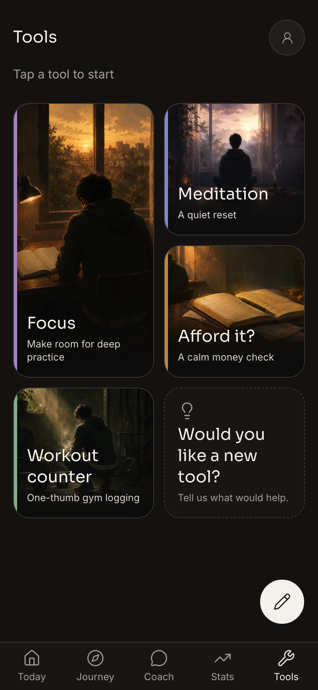 | 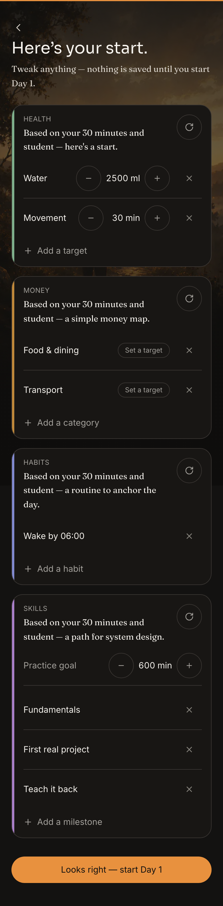 |

<details>
<summary><b>The same screens in light mode</b></summary>

| | | | |
|:--:|:--:|:--:|:--:|
| 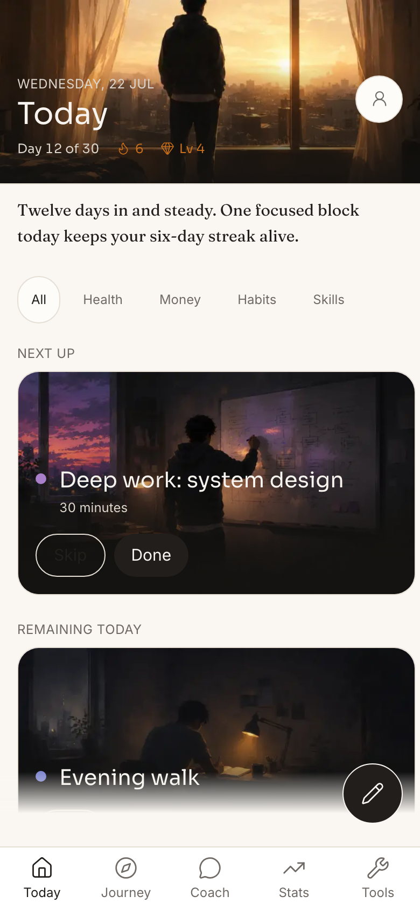 | 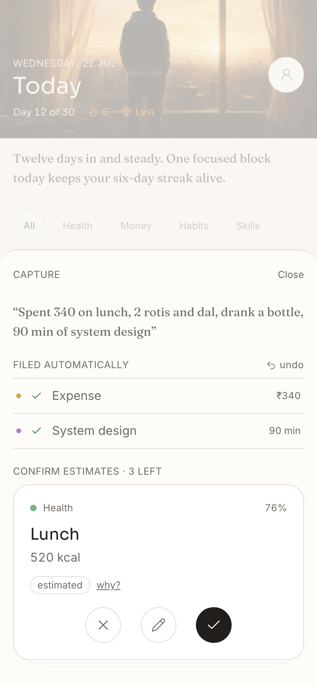 | 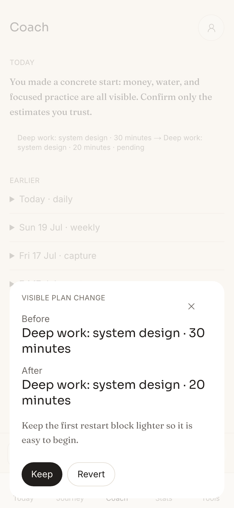 | 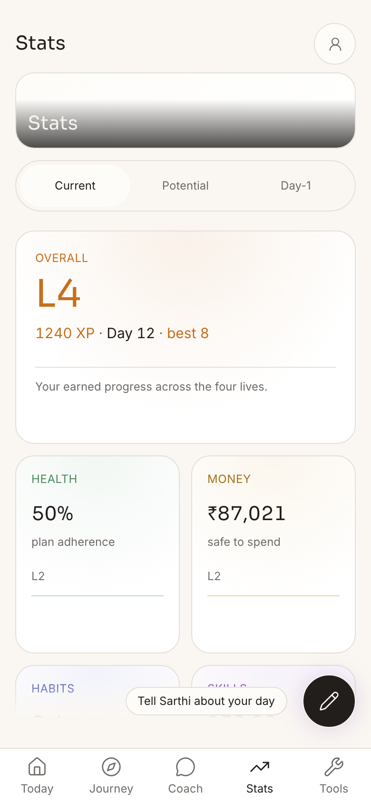 |
| 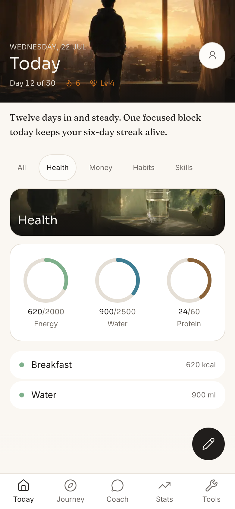 | 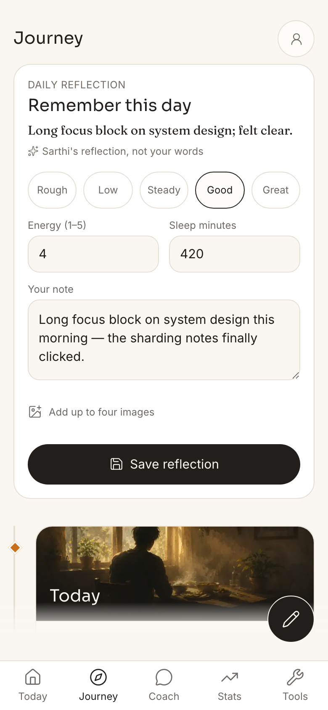 | 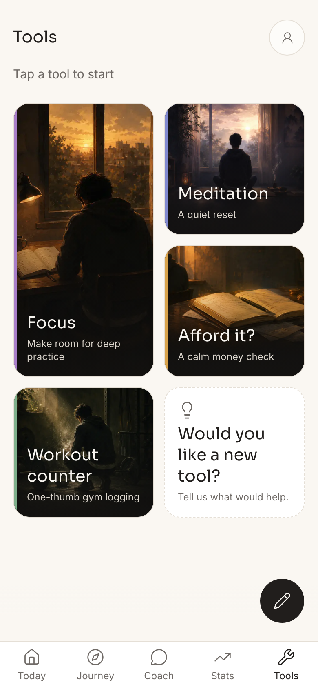 | 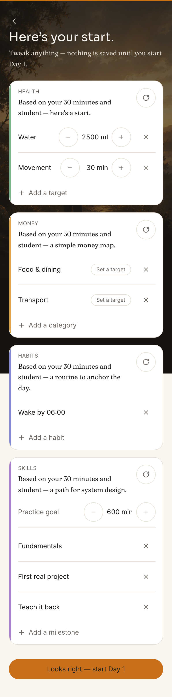 |

</details>

---

## 3. Sarthi inside ChatGPT — the user journey

Connect once (ChatGPT → Settings → Apps & Connectors → Developer mode → Plugins → Add custom MCP server → paste `https://sarthi-gray.vercel.app/mcp/<secret>` → No authentication). Then:

| Step | You say / do | What happens | Tool |
|---|---|---|---|
| 1 | *"Set up my Sarthi: I track meditation and water, I'm learning DSA."* | Your private space gets habits `Meditate`, `Water` and skill `DSA`. Only names you said; idempotent; never deletes. | `setup_space` |
| 2 | *"Spent 450 on a team lunch, had a paneer wrap and lassi, 45 min of DSA."* | ChatGPT fills typed entries. **₹450** and **45 min** are in your words → filed instantly. The meal's kcal was estimated → a card. | `log_entries` |
| 3 | The inline panel shows **Needs your OK** (the meal, with the reason *"ChatGPT estimated 650 kcal — that number isn't in your words"*), **Filed just now**, today's to-dos, and four Today tiles. | Cards live only in the panel (plus `window.openai.setWidgetState`); nothing pending is on the server. | panel resource |
| 4 | Tap **Keep** (or **Edit** a value, or **Discard**). | The panel calls the app-only tool with the card's token. Server re-validates, commits as kind `tap`, awards XP. ChatGPT cannot make this call. | `confirm_entry` |
| 5 | *"Undo that."* | The latest committed batch is reversed (5-minute window): rows soft-deleted or restored from snapshots, XP and Today back to before. | `undo_last` |
| 6 | *"Add 'submit DevDay project' to my day."* · *"Done with the DevDay project."* | A milestone lands on your **My days** arc; completion by exact title or id. A fuzzy Luna match is only a *suggestion*. | `add_todo`, `complete_todo` |
| 7 | Open the sidebar launcher → **Sarthi today**. | Health kcal/water/workout, Money spent, Habits done, Skills minutes, XP + your space names. | `get_today` |
| 8 | Open the web app. | Entries logged from ChatGPT appear in Today; matching plan tasks are ticked with a **"via ChatGPT"** badge (`components/today/PlanSpine.tsx`), and the coach line reacts to them. | — |

---

## 4. How OpenAI is used

| OpenAI capability | Where it lives in Sarthi | Why it matters |
|---|---|---|
| **ChatGPT plugins over MCP + MCP Apps inline panel** | `mcp/register.ts` registers tools with `@modelcontextprotocol/sdk` 1.32 and the panel resource with `@modelcontextprotocol/ext-apps`. `log_entries`, `confirm_entry`, `get_today` point at `ui://sarthi/panel.html`; `_meta["openai/ui"].availableDisplayModes = ["inline"]`; `get_today` adds a `global` entrypoint (the sidebar launcher). Status text via `openai/toolInvocation/invoking` → `invoked` ("Checking your words…" → "Sarthi decided"). | Logging happens where people already are; confirmation is one tap in the conversation, not a form in another tab. |
| **App-only tool visibility** | `confirm_entry` is registered with `_meta.ui.visibility: ["app"]` — visible to the panel, never to the model. | "Only the user confirms" becomes a platform guarantee, not a prompt instruction. |
| **ChatGPT's model as the parser** | The `log_entries` input schema (`modelEntrySchema`, zod 4, every field `.describe()`d) is filled directly by ChatGPT: `kind`, `estimated`, `confidence`, `amountRupees`, `kcal`, `millilitres`, `minutes`, `habitName`, … No second server-side parse call. | The strongest model in the loop does the understanding; Sarthi spends its effort on verification. |
| **Decisions API — `gpt-6-luna`** | `providers/decisions/openai.ts` calls `POST /v1/decisions` with **predicate** questions (one per auto-filing number: *"the user explicitly stated 45 min for DSA"*) and **choice** questions (map an unknown habit/skill/category name onto the user's existing ones). Batched into **one call per message**, hard-capped per process, timeboxed, cached by sha256, and **fail-closed** to the deterministic fake on any error. | A typed second opinion in milliseconds. **Demote-only:** probability < 0.8 sends a value to a card; a name pick ≥ 0.85 becomes a card to confirm. It never promotes a guess or invents a name. |
| **Per-user request metadata** | `_meta["openai/subject"]` keys each ChatGPT account to its own hashed Sarthi space; `_meta["openai/userLocation"].timezone` decides what "today" is. | Multi-user isolation with no account setup. |
| **OpenAI runtime adapter (optional)** | `providers/llm/matrix.ts` maps tiers to `gpt-5.6-sol` / `gpt-5.6-terra` / `gpt-5.6-luna` when `LLM_PROVIDER=openai`. On this branch the MCP layer runs the LLM gateway on `fake`. | Provider-blind core; flip by env. |

> **Two layers, never conflated.** The models the app *calls at runtime* are provider-neutral and default to a keyless fake. The *build* of Sarthi was done with Codex on GPT-5.6 in a plan → build → review agent mesh (see `docs/product/CHANGELOG.md`).

---

## 5. Architecture

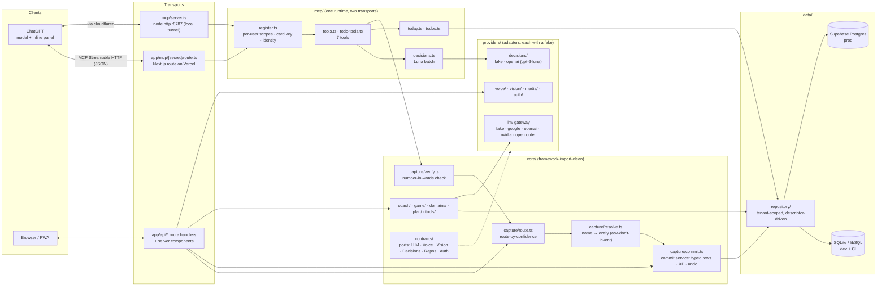

### Repo layout

| Path | What it holds |
|---|---|
| `app/` | Next.js 16 App Router: `(app)/today·coach·journey·stats·tools`, `(auth)/login·signup·reset-password`, `onboarding`, `admin`, `privacy`, `terms`, `waitlist`, `offline`; `app/api/*` route handlers (capture, coach, onboarding, tools, journey, try-demo, start-fresh, waitlist, settings/export); `app/mcp/[secret]/route.ts` (the ChatGPT app on Vercel) and `app/mcp/info/page.tsx` (public setup page); `app/lib/` (runtime config, session, admin). |
| `core/` | Framework-clean business logic. `capture/` (contract, parse, verify, route, resolve, commit, vision), `coach/` (engine, agent, memory, reflection, adaptation, registry), `domains/` (health, money, habits, skills, today views), `game/` (xp, streak, progress, views), `onboarding/`, `plan/rollover`, `tools/` (focus/meditation/workout/afford + integer `units`), `voice/`, `time/`, `contracts/` (all ports). A boundary script fails the build if `core/` imports Next/React. |
| `mcp/` | The ChatGPT app: `register.ts` (runtime + tool registration, shared by both transports), `tools.ts`, `todo-tools.ts`, `todos.ts`, `decisions.ts`, `today.ts`, `server.ts` (local Node transport), `panel.html` (the inline MCP Apps panel, tokens-only CSS, no external fonts). |
| `providers/` | Adapters behind the ports: `llm/` (AI SDK gateway + model matrix), `decisions/` (fake + OpenAI), `vision/`, `voice/`, `media/`, `auth/` (anonymous sandbox cookie, local-password, Supabase), `fake/` (deterministic canned parse/vision/voice). |
| `data/` | `schema/contract.ts` (single source of truth: descriptors + zod create/update schemas for all 38 tables), `schema/sqlite.ts` + `schema/postgres.ts` (dual dialect), `db/`, `repository/` (base, scope, factory, commits, coach-memory, admin). |
| `components/` | UI: `capture/` (orb, sheet, estimate deck, cards), `today/`, `lenses/`, `coach/`, `journey/`, `stats/`, `tools/`, `onboarding/`, `auth/`, `landing/`, `settings/`, `shell/`, `pwa/`, `ui/`, `art/`. |
| `tests/` | ~50 `node:test` suites incl. `tests/eval/` (the eval harness). |
| `scripts/` | `seed-dev.ts`, `seed-postgres.ts`, `check-core-boundary.mjs`, `screenshot.mjs`, `build-art.mjs`. |
| `drizzle*/` | Generated migrations (SQLite + Postgres configs). |
| `docs/` | Product, architecture, design, screens, flows, decisions, handoffs. |

### Provider-blind ports

Every external dependency sits behind an interface in `core/contracts/` with a deterministic `fake` adapter, so the whole loop runs keyless:

| Port | Adapters | Selected by |
|---|---|---|
| LLM (`LlmGateway`, tiers deep/balanced/fast) | fake · google · openai · nvidia · openrouter (anthropic wired but disabled) | `LLM_PROVIDER` |
| Voice (transcription) | fake · gemini · sarvam · openai · webspeech | `VOICE_PROVIDER` |
| Vision (plate / receipt) | fake · google · openai | `VISION_PROVIDER` |
| Media (reflection photos) | fake · production | env |
| Decisions (`DecisionProvider`) | fake · openai (`gpt-6-luna`) | `DECISIONS_PROVIDER` |
| Auth | anonymous (sandbox cookie) · local-password · supabase | `AUTH_PROVIDER` |
| DB (`RepositoryFactory`) | SQLite/libSQL · Postgres (one Drizzle repository impl) | `DATABASE_PROVIDER` |

---

## 6. The trust pipeline

### `log_entries` — from ChatGPT's tool call to a typed row (or a card)

```mermaid
sequenceDiagram
  autonumber
  participant M as ChatGPT model
  participant T as mcp/tools.ts logEntries
  participant V as core/capture/verify.ts
  participant L as mcp/decisions.ts (Luna)
  participant R as core/capture route + resolve
  participant C as commit service
  participant DB as repositories (per-user)
  participant P as Inline panel

  M->>T: log_entries({ text: verbatim words, entries[] })
  T->>T: ModelEntry → Proposal (server integer units: rupees→paise, kg→grams, counts rounded; missing required → Question, nothing filed)
  loop each proposal
    T->>V: verifyAgainstText(proposal, text)
    V-->>T: untouched, or demoted (estimated:true, bps ≤ 8999, reason "…isn't in your words")
  end
  T->>L: lunaCheck(text, proposals, space names) — ONE batched call
  L-->>T: predicates p<0.8 → demote · choices conf≥0.85 → rename + demote to card · never promote
  loop each proposal
    T->>R: routeProposal → auto | pending
    alt auto
      T->>R: resolveProposal(…, "auto") — category/habit/skill name → id
      R-->>T: ok (resolved) | not ok (Question + card)
    else pending
      T-->>T: Card (title, value, unit, reasons, proposal echoed)
    end
  end
  T->>C: commit({ idempotencyKey: sha256(text+entries), kind:"capture", proposals: auto })
  C->>DB: one transaction: supersede prior batch · envelope · typed rows · commit_rows snapshots · XP/streak · tick plan items (completionSource "chatgpt")
  C-->>T: { commitId, status: committed | replayed }
  T-->>M: structuredContent { filed, pending, questions, today, space, todos, decisions, message }
  T-->>P: result _meta["sarthi/cardTokens"] = { cardId → HMAC token } (never shown to the model)
```

### Keep — `confirm_entry` (app-only)

```mermaid
sequenceDiagram
  autonumber
  participant P as Inline panel (user tap)
  participant G as mcp/register.ts
  participant T as confirmEntryRouted / confirmEntry
  participant R as resolveProposal
  participant C as commit service

  P->>G: confirm_entry({ proposal, value?, cardToken }) — tool has ui.visibility ["app"]
  G->>T: route by identity: request subject, else the token's SIGNED owner (never local-dev in multi-user)
  T->>T: proposalSchema.parse(proposal)
  T->>T: verifyCardToken: HMAC-SHA256(key, cardId.owner.canonicalJSON(proposal)) — constant-time; owner must equal the request's space
  alt token missing / forged / other owner
    T-->>P: isError "This card can only be confirmed from the Sarthi panel." (nothing written)
  end
  opt user edited the value
    T->>T: applyUserEdit → estimated:false, bps 10000, why "user edit"
  end
  T->>R: resolveProposal(…, "accepted")
  T->>C: commit({ idempotencyKey: proposalId, kind:"tap", proposals:[resolved] })
  C-->>T: committed | replayed ("was already filed")
  T-->>P: { filed:[…], confirmedCardId, today, lastCommitId, message }
```

### Routing rules (`core/capture/route.ts`)

A proposal is `auto` **only** if every row below is false. Anything else is `pending` and writes only on an explicit accept.

| Rule | Condition | Reason shown on the card |
|---|---|---|
| Intent | `intent !== "create"` (update/delete) | "requires explicit confirmation" |
| Estimated | `estimated === true` (set by the model, by `verifyAgainstText`, or by Luna) | "estimated value must be confirmed" |
| Confidence | `confidenceBps < 9000` (`AUTO_WRITE_CONFIDENCE_BPS`) | "confidence N below auto threshold 9000" |
| Unknown quantity | `water.millilitres === null` ("drank a bottle") | "a required quantity is unknown" |
| Photo evidence | `evidenceRefs.length > 0` — a vision-derived value never auto-writes, even a printed receipt total | "photo-derived value requires confirmation" |
| Open question | the proposal is blocked by an unanswered clarification | "a clarification question must be answered first" |
| Ask-don't-invent | an unknown category / habit / skill name (`resolve.ts`), or a missing required field in the tool args | a `Question` is returned; **nothing is filed** and no phantom entity is created |

Two independent checks — pure code (`verifyAgainstText`) and Luna — both have to pass before a number auto-files; either one alone can demote.

### Undo semantics (`core/capture/commit.ts`)

- Every commit writes an **envelope** (`commits`) plus one **`commit_rows`** snapshot per typed row (`beforeJson` / `afterJson`), per-domain XP/streak effects (`commit_progress_effects`) and plan ticks (`commit_plan_effects`).
- There is **at most one `committed` batch at a time**: each new commit marks the previous one `superseded`. `undo_last` finds the latest `committed` envelope and calls `undoLatest`.
- Undo is refused (honestly, nothing changed) when the **5-minute window** (`undoExpiresAt`) has passed or the batch is not the latest.
- Undo runs in one transaction: created rows are **soft-deleted**, updated rows (plan items, `domain_progress`) are **restored from their `beforeJson` snapshot**, kept coach adaptations linked to that commit flip to `reverted`, the envelope becomes `undone`.
- Idempotency: `(userId, idempotencyKey)` is unique; a host retry **replays** instead of writing twice. Saying the same sentence again after an undo is a new log (the key is chained off the undone commit id).

---

## 7. Multi-user and identity

| Mode | Who | How |
|---|---|---|
| `MULTI_USER=0` (local default) | one space, `userId = "local-dev"` | what `pnpm db:seed:dev` seeds |
| `MULTI_USER=1` (production ChatGPT app) | one space per ChatGPT account | `userId = "cg_" + sha256("sarthi-user-v1:" + openai/subject)[0:24]`; the 24-hex-char hash is also the card **ownerKey** |

**First-sight provisioning** (`ensureProvisioned`, one transaction, idempotent): a `profiles` row (timezone from `openai/userLocation`, else `Asia/Kolkata`; `onboardingStatus: "complete"`, `plan: "free"`), default money categories **Food & dining** and **Transport**, zeroed `domain_progress` rows for `overall / health / money / habits / skills`, and an open-ended **"My days"** overall arc so to-dos have a home. No habits, no skills, no history — the user builds those by talking (`setup_space`).

**No subject → no data.** In multi-user mode a call without `openai/subject` gets an honest empty state (*"Couldn't identify your ChatGPT account"*) and never falls back to `local-dev`. Error states carry an empty Today so a failure can never leak another space.

**Owner-bound cards.** Tokens are `${ownerKey}.${HMAC}`; a request may confirm only cards signed for its own space ("This card belongs to another Sarthi space."). A panel call with no subject acts only as the token's signed owner, and only if that owner was actually provisioned.

**Web app identity** (separate from ChatGPT): `AUTH_PROVIDER=anonymous` mints a per-visitor sandbox cookie (`/api/try-demo` seeds a 12-day life into it; `/api/start-fresh` an empty one), `local-password` is a single-user dev gate, `supabase` is real multi-user auth. All three resolve to a `userId` that the repository factory scopes on.

**Not done:** OAuth account linking — a ChatGPT space and a web-app account are different `userId`s today.

---

## 8. Database design

38 tables, all defined once in `data/schema/contract.ts` (column descriptors + zod create/update schemas) and materialised for two dialects: `data/schema/sqlite.ts` (dev/CI, libSQL) and `data/schema/postgres.ts` (prod, Supabase). `tests/parity.test.ts` asserts the two stay identical. The repository layer (`data/repository/base.ts`) is descriptor-driven: one implementation serves every table.

**Conventions**

- **Typed per-domain stores.** Each accepted proposal becomes a row in its own table (`meals`, `transactions`, `habit_logs`, …). Nothing generic persists.
- **Integer units.** `amountPaise`, `limitPaise`, `millilitres`, `kcal`, `*Grams`, `minutes`, `durationMinutes`, `loadGrams`, `confidenceBps` (0–10000). No float columns for money or quantity.
- **Provenance on every captured row:** `source`, `estimated`, `confidenceBps`, `occurredAt`, `localDate`, `timezone`, optional `evidenceId`.
- **Tenant scoping.** Every table has `userId`. Repositories read it **only** from the `ScopeContext` minted by `factory.forUser(user)`; a caller-supplied `userId` on create/query is ignored, and every unique index is `(userId, …)`. The only unscoped seam is the gated admin waitlist repository.
- **Mutable vs append-only.** Mutable tables carry `createdAt/updatedAt/deletedAt` and support **soft delete** (undo never hard-deletes). Ledger/audit tables (`commits`, `commit_rows`, `coach_notes`, `coach_messages`, …) are append-only.
- **JSON columns** carry only named shapes (`PlanRule`, `CommitRowSnapshot`, …).

### Tables by group

| Group | Table | Key columns / constraints |
|---|---|---|
| **Profile** | `profiles` | PK `userId`; `timezone`, `theme`, `unitSystem`, `wakeTimeMinutes`, `plan` (free/pro), `onboardingStatus`, `seedVersion` |
| | `profile_gaps`, `seed_runs` | `(userId, gapKey)` / `(userId, seedKey)` unique |
| **Money** | `money_categories` | `name`, `kind` (expense/income), `isSystem`; unique `(userId, name, kind)` |
| | `transactions` | `direction`, `amountPaise`, `categoryId`, `merchant`, `note`, `recurringRuleId`, provenance; indexed `(userId, localDate)` |
| | `recurring_rules` | `amountPaise`, `cadence`, `nextPostDate`, `isPaused` |
| | `budgets` | `limitPaise`; unique `(userId, categoryId, periodStart, periodEnd)` |
| **Health** | `meals` / `meal_items` | `kcal`, `proteinGrams`, `carbsGrams`, `fatGrams`, `note`; items have `quantityGrams` and their own `estimated` |
| | `water_logs` | `millilitres` |
| | `workouts` / `workout_exercises` | `durationMinutes`, `burnKcal`; exercises `sets`, `reps`, `loadGrams`, `sortOrder` |
| | `weigh_ins` | `weightGrams` |
| **Habits** | `habits` | `cadence`, `difficulty`, `targetValue/Unit`, `isArchived`; unique `(userId, name)` |
| | `habit_logs` | `habitId`, `status` (done/skipped); unique `(userId, habitId, localDate)` |
| | `habit_satisfaction_rules` | "tick habit X when `sourceDomain.sourceKind.aggregateField ≥ minimumValue`" |
| **Skills** | `skills` | `targetMinutes`, `isArchived`; unique `(userId, name)` |
| | `skill_milestones` | `label`, `sortOrder`, `completedAt`; unique `(userId, skillId, sortOrder)` |
| | `skill_sessions` | `minutes`, provenance; indexed `(userId, skillId, localDate)` |
| **Plan / Today** | `plan_arcs` | `domain` (health/money/habits/skills/**overall**), `mode`, `title`, `startDate`, `endDate`, `dayNumber`, `status` |
| | `plan_items` | `arcId`, `domain`, `kind` (incl. `milestone` = to-do), `title`, `localDate`, `targetValue/Unit`, `status`, `completionSource` (manual/capture/chatgpt/tool), `ruleJson`, `linkedHabitId/SkillId` |
| | `day_one_snapshots` | append-only onboarding baseline |
| **Game / Progress** | `domain_progress` | `xp`, `level`, `streak`, `bestStreak`, `cumulativeMinutes`, `lastActiveDate`; unique `(userId, domain)` |
| **Capture ledger** | `commits` | `idempotencyKey` (unique per user), `kind` (capture/tap/tool/adaptation), `status` (committed/superseded/undone), `undoExpiresAt`, `summary` |
| | `commit_rows` | `commitId`, `entryKind`, `entryId`, `operation`, `beforeJson`, `afterJson`; unique `(userId, commitId, entryKind, entryId)` |
| | `commit_progress_effects`, `commit_plan_effects` | XP/level/streak deltas and plan-item status transitions per commit (exact undo) |
| **Coach** | `coach_notes` | append-only notes with `scope` + `stalenessKey` (invalidated by undo) |
| | `coach_messages` | append-only chat transcript |
| | `coach_memory` / `coach_memory_audit` | bounded long-term memory with lifecycle updates + audit trail |
| | `adaptations` | glass-box plan changes: before/after/reason, `status` kept/reverted, `appliedCommitId` |
| **Evidence / Journey** | `evidence` | photo/receipt evidence; unique `(userId, sha256)` |
| | `daily_reflections` | unique `(userId, localDate)` |
| | `reflection_media` | unique `(userId, sha256)` |
| **Auth / Billing** | `checkout_sessions`, `billing_events`, `waitlist` | Razorpay-shaped checkout rail (Pro flag), provider event dedupe, waitlist by email |

### Core relationships

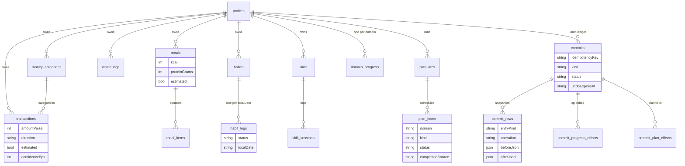

---

## 9. To-dos

The to-do layer reuses the Today plan rather than adding a domain (`mcp/todos.ts`):

- A to-do is a `plan_items` row with `domain: "overall"` (never a real domain, so captures cannot auto-tick it), `kind: "milestone"`, `localDate` = the user's today, on the active **"My days"** overall arc. No XP.
- `ensurePlanRolledOver` runs first, so an incomplete milestone **carries forward** day to day and a done one never repeats.
- `add_todo`: only titles the user said (max 10 per call, 120 chars), case-insensitive de-dupe against today's open list, created inside a transaction. Fresh ChatGPT spaces get the arc created on demand.
- `complete_todo`: by `todoId` or exact title → `status: "done"`, `completionSource: "manual"` (the same update the web app's Done tap uses). If nothing matches exactly, **one Luna choice question** over today's open titles may return a *suggestion* (≥ 0.85) — *"Did you mean …? Nothing was changed."* — a fuzzy match never writes. Never creates.
- To-dos ride along in every tool result (`todos`) so the panel stays current.

---

## 10. Decisions API (GPT-6 Luna) details

| Item | Value |
|---|---|
| Endpoint | `POST https://api.openai.com/v1/decisions`, bearer `OPENAI_API_KEY` |
| Model | `gpt-6-luna` (`DECISIONS_MODEL`) |
| Question types | **predicate** → `{ probability }`; **choice** → `{ choice, confidence }` over the user's existing names + `"none"` (max 254 choices) |
| When asked | Only for values that passed the code check *and* would otherwise auto-file (one predicate per number: amount, kcal, macros, ml, minutes, burn kcal, kg); one choice per unmatched category/habit/skill name when the user has existing names |
| Thresholds | predicate `< 0.8` → demote to card (`estimated:true`, bps ≤ 8999, reason *"Luna: 23% likely you stated 420 kcal"*); choice `≥ 0.85` and not `"none"` → rename to the existing entity **and** demote to a card ("tap Keep to confirm") |
| Batching | one `decide()` per `log_entries` message; `complete_todo` makes at most one extra call |
| Cap | `DECISIONS_MAX_CALLS` (default 25 per process; counted *before* the request so a timed-out call is still counted) |
| Timeout | `DECISIONS_TIMEOUT_MS` (default 2500, clamped 500–15000) via `AbortController` |
| Cache | in-memory, keyed `sha256(input ‖ wire questions)`; only fully-live, non-degraded answers are cached |
| Fallback | no key, cap reached, HTTP error, timeout, malformed body, refusal, unknown choice → the deterministic **fake** answer for that question (0.99 if the number is literally in the text, else 0.05; exact name match or `"none"`). **Fail closed:** worst case is an extra card, never an extra silent write |
| Selection | `DECISIONS_PROVIDER=openai` else `fake` (keyless default; CI runs fake) |
| Telemetry | each result carries `decisions: { provider, calls, cached, checked }` and the server logs `luna …` lines |

---

## 11. Security and hardening

The MCP endpoint is public and unauthenticated by design (ChatGPT "No authentication" connectors), so the surface is deliberately small:

- **Capability URL.** On Vercel the app lives only at `/mcp/<MCP_SECRET>`; the path segment is compared **constant-time** (sha256 both sides, `timingSafeEqual`) and anything else — or `MCP_SECRET` unset — is a plain 404. The local server does the same with the raw path bytes and prints a loud warning if it starts without a secret.
- **Local bind.** `mcp/server.ts` listens on `127.0.0.1` only; `cloudflared` connects over localhost.
- **Body cap.** 64 KB (`MAX_BODY_BYTES`): checked against `Content-Length`, then enforced while streaming; over-cap → 413 and the connection is closed.
- **Input caps (zod).** `text ≤ 2000` chars, `entries ≤ 20`, strings ≤ 200, numbers `0 ≤ n ≤ 10,000,000` and finite, confidence 0–100, to-do titles ≤ 120, ≤ 10 per call.
- **Generic errors.** Handlers are wrapped in `safely` / `safelyAnonymous`: stack traces and driver messages are logged server-side only; the client gets *"Sarthi hit a problem and nothing was changed."* Unique-constraint collisions become an honest *"already exists"*.
- **App-only confirmation + HMAC card tokens.** `confirm_entry` is `ui.visibility: ["app"]`; each card's token is `owner.HMAC-SHA256(key, cardId.owner.canonicalJSON(proposal))`, delivered only via result `_meta` (never in model-visible content), verified constant-time, bound to the exact proposal and owner. The key derives from `MCP_SECRET` (stable across serverless instances) or a per-process random secret locally. `REQUIRE_CARD_TOKEN=0` disables the check and logs a loud warning.
- **Stateless transport.** One `McpServer` per request, JSON responses, GET → 405 (no server-initiated SSE), CORS `*` with only `content-type, mcp-session-id`.
- **Middleware exclusion.** The web app's auth middleware matcher excludes `/mcp/*` and `/api/*`, so the MCP route never gets a sandbox cookie minted or an auth redirect.
- **Tenant isolation at the data layer.** `userId` is injected from the scope context; repositories ignore caller-supplied tenant filters (see §8).
- **Not yet:** per-IP / per-subject rate limiting (listed in §16).

---

## 12. Provider matrix

From `providers/llm/matrix.ts` (`LLM_MODEL_MATRIX`); IDs are verified against each provider's `GET /v1/models`, not guessed.

| `LLM_PROVIDER` | deep (briefs, planning, long chat) | balanced | fast (capture parse, vision, short coaching) | Key |
|---|---|---|---|---|
| `fake` (default) | `fake-deep-v1` | `fake-balanced-v1` | `fake-fast-v1` | none |
| `google` | `gemini-2.5-flash` | `gemini-flash-lite-latest` | `gemini-flash-lite-latest` | `GOOGLE_API_KEY` |
| `openai` | `gpt-5.6-sol` | `gpt-5.6-terra` | `gpt-5.6-luna` | `OPENAI_API_KEY` |
| `anthropic` | — (disabled: no verified ID) | — | — | `ANTHROPIC_API_KEY` |
| `nvidia` (NIM, OpenAI-compatible) | `nvidia/nemotron-3-super-120b-a12b` | `google/gemma-4-31b-it` | `nvidia/nemotron-3.5-lightning-30b-a3b` | `NVIDIA_API_KEY` |
| `openrouter` | `nvidia/nemotron-3-super-120b-a12b:free` | same | same | `OPENROUTER_API_KEY` |

Voice: `fake · gemini · sarvam · openai · webspeech`. Vision: `fake · google · openai`. Decisions: `fake · openai`. In the web app, a user can also paste their own Gemini/OpenAI key under *Settings → Your AI key*; it stays in the browser and is scrubbed from errors.

---

## 13. Run locally

**Requirements:** Node ≥ 22, pnpm 11.9.

```bash
pnpm install

# Seed the 12-day demo life into ./sarthi.dev.db (resets the file and applies
# migrations itself — no separate migrate step needed for a fresh db).
SEED_STATE=populated pnpm db:seed:dev

pnpm dev        # web app → http://localhost:3000  (keyless fake stack, user "local-dev")
pnpm mcp:dev    # ChatGPT app → http://127.0.0.1:8787/mcp (or /mcp/<MCP_SECRET>)
```

To connect ChatGPT to the local server:

```bash
export MCP_SECRET=<secret>                         # recommended before tunnelling
MULTI_USER=1 MCP_SECRET=$MCP_SECRET pnpm mcp:dev   # optional: one space per ChatGPT account
cloudflared tunnel --url http://localhost:8787     # copy https://….trycloudflare.com
```

Then in ChatGPT: Settings → Apps & Connectors → Developer mode → Plugins → **Add custom MCP server** → `https://<tunnel>/mcp/<secret>` → No authentication → Refresh. Attach Sarthi in a chat (`@` on desktop, `+` on web) and say *"Set up my Sarthi: I track meditation and water, I'm learning DSA."* The full step list is at `/mcp/info`.

Other scripts: `pnpm db:generate` / `pnpm db:migrate` (SQLite drizzle-kit), `pnpm db:generate:postgres` / `pnpm db:push:postgres` / `pnpm db:seed:postgres`, `pnpm screenshots`, `pnpm art:build`.

### Environment reference

Everything defaults to the keyless fake stack; a blank value reads as unset.

| Variable | Default | Purpose |
|---|---|---|
| `LLM_PROVIDER` | `fake` | `fake · google · openai · anthropic · nvidia · openrouter` |
| `VOICE_PROVIDER` | `fake` | `fake · gemini · sarvam · openai · webspeech` |
| `VISION_PROVIDER` | `fake` | `fake · google · openai` |
| `AUTH_PROVIDER` | `local-password` | `local-password · anonymous · supabase` |
| `DATABASE_PROVIDER` | `sqlite` | `sqlite · postgres` |
| `DB_URL` | `file:./sarthi.dev.db` | SQLite file / libSQL URL, or the Postgres connection string |
| `DB_AUTH_TOKEN` | — | only for hosted libSQL/Turso |
| `APP_PASSWORD` | — | local-password gate (→ `userId` `local-dev`) |
| `BILLING_MODE` | `waitlist` | `waitlist · checkout` |
| `JUDGE_MODE` | `false` | judge-safe free access |
| `GOOGLE_API_KEY`, `OPENAI_API_KEY`, `ANTHROPIC_API_KEY`, `NVIDIA_API_KEY`, `OPENROUTER_API_KEY`, `SARVAM_API_KEY` | — | runtime provider keys; `OPENAI_API_KEY` also powers the Decisions API |
| `SUPABASE_*`, `DATABASE_URL`, `DIRECT_URL` | — | Supabase project + pooler strings (see `.env.example`) |
| **MCP** | | |
| `MCP_SECRET` | — | capability-URL segment and card-token HMAC key. Vercel route 404s without it |
| `MULTI_USER` | `0` | `1` → one space per ChatGPT `openai/subject` |
| `REQUIRE_CARD_TOKEN` | `1` | `0` disables panel-token enforcement (dev only; logs a warning) |
| `SARTHI_PUBLIC_ORIGIN` | request origin (Vercel) / none (local) | origin the panel may load `/art/*.webp` from (MCP Apps CSP + `openai/widgetCSP`) |
| `SARTHI_PANEL_PATH` | `mcp/panel.html` | local override for the panel file |
| `PORT` | `8787` | local MCP server port |
| `DECISIONS_PROVIDER` | `fake` | `openai` to call `gpt-6-luna` |
| `DECISIONS_MAX_CALLS` | `25` | per-process live-call cap |
| `DECISIONS_TIMEOUT_MS` | `2500` | 500–15000 |
| `MCP_INFO_SHOW_CONNECTOR` | — | `1` renders the full plugin URL on `/mcp/info` (off in public deploys) |

---

## 14. Testing and quality

Everything runs keyless on the fake stack with a throwaway SQLite file — **348 tests** on this branch, `node:test` via `tsx`, plus a hard boundary check.

| Script | Covers |
|---|---|
| `test:core-boundary` + `check:core-boundary` | `core/` has no Next/React imports |
| `test:providers` | LLM/voice/vision gateways and the model matrix |
| `test:data` | schema contract, **SQLite ↔ Postgres parity**, repository scoping, transactions, auth, commit state machine, admin seam |
| `test:migrations` | migrations apply cleanly |
| `test:capture` | capture contract, route-by-confidence, parse, voice, commit, **commit origin ("via ChatGPT")**, undo, vision, **`verify.test.ts`** (number-in-words), **`mcp-card-token`**, **`mcp-habit-conflict`**, **`mcp-multi-user`**, **`mcp-todos`**, **`decisions.test.ts`** |
| `test:domains`, `test:views`, `test:tools` | Health/Money/Habits/Skills views, Today, tools (focus/meditation/workout/afford); XP/streak (`game.test.ts`) runs under `test:capture` |
| `test:coach` | coach engine, reflection, agent, memory |
| `test:onboarding`, `test:ui`, `test:offline`, `test:art` | onboarding spine/accept/detail, design tokens, capture deck, offline queue, art manifest |
| `test:eval` | **eval harness**: `f3-gate` (the canonical capture loop), `f5-receipt` (photo path), `timer-session`, `coach-agent` — each reports `wrongSilentWrites` and asserts it is **0** |

`pnpm check` = typecheck + lint + core-boundary + all suites. **CI** (`.github/workflows/ci.yml`) runs `pnpm check` and `pnpm build` on every push/PR with the fake stack and SQLite.

---

## 15. Deployment

- **Vercel** hosts the Next.js app and the ChatGPT app in one deploy. `app/mcp/[secret]/route.ts` is `runtime = "nodejs"`, `dynamic = "force-dynamic"`, `maxDuration = 60`, and reuses the same memoised repository factory as the web app.
- **Supabase Postgres**: `DATABASE_PROVIDER=postgres`, `DB_URL` = the **transaction pooler** string (port 6543, IPv4, `prepare:false`, `max:1`) for the app; migrations and `pnpm db:seed:postgres` use the direct/session string.
- Env on Vercel: the provider selectors above, `MCP_SECRET`, `MULTI_USER=1`, `SARTHI_PUBLIC_ORIGIN=https://sarthi-gray.vercel.app`, `DECISIONS_PROVIDER=openai` + `OPENAI_API_KEY` (optional; falls back to fake), `AUTH_PROVIDER=supabase` + Supabase keys for real accounts.
- The connector URL shared with judges is `https://sarthi-gray.vercel.app/mcp/<secret>`; `/mcp/info` documents setup without exposing it.
- Cards survive serverless cold starts because the HMAC key derives from `MCP_SECRET`, not process memory; the panel keeps pending cards in widget state.

---

## 16. Known limitations and roadmap

- **OAuth account linking.** A ChatGPT space (`cg_…`) and a web account are separate today. Next: sign in with your Sarthi account inside ChatGPT so both surfaces share one `userId`.
- **Rate limiting.** The MCP endpoint relies on the secret path + body/input caps; per-IP / per-subject throttling is not implemented.
- **Postgres in CI.** CI runs SQLite; Postgres is covered by the schema parity test and manual deploys, not an automated pg job.
- **Position-aware number check.** `verifyAgainstText` checks that each number token appears *anywhere* in the text, so "2 rotis" could vouch for an unrelated "2". Luna's predicate is the second line; a span-aware check is the next hardening step.
- **Undo for to-dos.** `undo_last` covers capture/tap commits; `add_todo`/`complete_todo` use a plain plan-item update outside the ledger and are not undoable yet.
- **Habit re-log after undo.** `habit_logs` is unique on `(userId, habitId, localDate)` and undo soft-deletes, so re-logging the same habit the same day after an undo is refused with an honest message until a partial unique index lands.
- **iOS Health.** A native Expo shell on the shared `core/` with Apple Health import is in progress on a separate branch.
- **Desktop layout, proactive coach, more domains** — on the product roadmap; each new domain is a schema + a lens.

---

## 17. License

MIT © 2026 Satvik Sawhney — see [`LICENSE`](LICENSE).

<div align="center">
<sub>Sarthi collapses four trackers into one sentence — and never saves a guess without asking.</sub>
</div>
